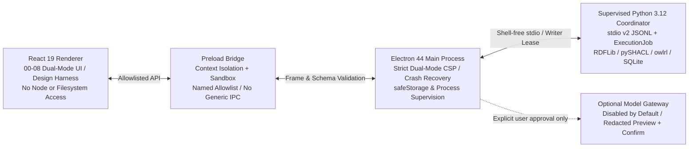

<div align="center">
  
  <h1>OntoLearn Studio</h1>
  <p>
    <strong>A Local-First Desktop Workbench for Zero-Code &amp; Semantic Ontology Learning and Engineering</strong>
  </p>
  <p>
    <a href="README.md">简体中文</a> | <strong>English</strong>
  </p>
  <p>
    <a href="https://github.com/NOmoreJoke/OntoLearn-Studio/releases/latest">
      
    </a>
    <a href="https://github.com/NOmoreJoke/OntoLearn-Studio/actions/workflows/ci.yml">
      
    </a>
    <a href="LICENSE">
      
    </a>
    
  </p>
</div>

---

**OntoLearn Studio** is a local-first desktop workbench built for both non-coding business/product practitioners and ontology engineers. It unifies a **zero-code concept sandbox**, a **standards-based RDF/SHACL engineering workbench**, an **atomic SQLite snapshot store**, and an **offline curriculum mentor** inside a self-contained desktop package—no separate Python or Node.js installation is required for end users.

---

## Key Capabilities

1. **Local-First & Offline-Safe by Default**
   - Bundles a frozen Python 3.12 semantic engine (`RDFLib` + `pySHACL` + `owlrl`) and an atomic SQLite transaction store; projects and checkpoints stay entirely on local disk.
   - Zero accounts and zero telemetry. Optional LLM model assistance is disabled by default, requires encrypted credential storage (`safeStorage`), redacted payload preview, and explicit human confirmation per call, and only produces drafts for manual review.
2. **Dual-View Parity: Business Intuition ↔ Standard Semantic Graph**
   - The default beginner view hides raw `<urn:...>` namespaces, N3 datatype suffixes, and raw JSON dumps behind an **Excel row-to-triple builder**, **PRD 4-color term highlighter**, **natural-language dropdown sentence builder**, and a 3-column **`ReadableBusinessDiff`** table.
   - Switch to **Standard RDF/IRI View** in one click or expand the underlying triple/JSON drawer at any time.
3. **Two-Tier Case Progression & Dual-Scale Simulation Datasets**
   - Ships **Lv.1 Zhiwei Tea (Omnichannel Retail Membership & Store Orders)** for zero-code learners with one-click switching between a **10-row sandbox set** and an **80-row dirty-data stress set**, alongside **Lv.2 Smart Factory (Equipment Ops & Alert Closed-Loop)** for engineering transfer practice.
4. **Explainable Validation & Deterministic Rollback**
   - Every write follows preview → confirmation → atomic commit, generating immutable snapshots, fine-grained downstream invalidation reasons, full-project checkpoint restore, and portable `.zip` project transfer.

---

## Two-Tier Learning Curriculum

| Tier                             | Domain Scenario                                        | Prefix             | Dataset & Pedagogical Role                                                                                                                                                                                                                                                                     |
| :------------------------------- | :----------------------------------------------------- | :----------------- | :--------------------------------------------------------------------------------------------------------------------------------------------------------------------------------------------------------------------------------------------------------------------------------------------- |
| **Lv.1 (Zero-Code Recommended)** | **Zhiwei Tea · Retail Membership & Order Fulfillment** | `retail:`          | 4 business tables (`members`, `stores_staff`, `orders`, `complaints`); switches between a **10-row starter set** (triples, identity disambiguation, event reification) and an **80-row dirty-data stress set** (catching negative payments, dangling manager IDs, and high-risk churn members) |
| **Lv.2 (Engineering Transfer)**  | **Smart Factory · Equipment Operations & Alerts**      | Engineering corpus | Preserves the full offline engineering curriculum, mapping templates, SPARQL query exercises, and migration/repair tasks                                                                                                                                                                       |

---

## `00` – `08` Workbench Modules

| Module         | Name                              | Summary                                                                                                                                                                                                                         |
| :------------- | :-------------------------------- | :------------------------------------------------------------------------------------------------------------------------------------------------------------------------------------------------------------------------------ |
| **`00`**       | **Triple & Concept Sandbox**      | 6 guided zero-code steps: table-row `S–P–O` splitting, identity vs. label disambiguation, object links vs. literal attributes, classes vs. instances, PRD highlighting & anti-pattern clinic, and assertions vs. inferred facts |
| **`01`**       | **Ontology Builder**              | Instant toggle between `[Zero-Code Business View \| Standard RDF/IRI View]`, dropdown sentence builder, `ReadableBusinessDiff` preview, and atomic commit                                                                       |
| **`02`**       | **Data Mapping**                  | CSV / Excel (`.xlsx`) mapping, stable entity identity checks, malformed-input rejection, and snapshot-traceable import                                                                                                          |
| **`03`**       | **Ontology Query**                | Local read-only SPARQL & visual query builder (`SERVICE` and updates blocked), bounded pagination, same-snapshot graph view, historical snapshot replay, and CSV export                                                         |
| **`04`**       | **Quality & Reasoning**           | pySHACL structural validation, bounded single-phase rules & RDFS/OWL-RL subset inference, 10/80-row stress validation, and plain-language proof chains                                                                          |
| **`05`**       | **Behavior Rules**                | Event-triggered rule definitions and sandbox checks with upstream snapshot invalidation tracking                                                                                                                                |
| **`06`**       | **Scenario Simulation**           | Deterministic multi-round scenario runs based on explicit rules and inputs                                                                                                                                                      |
| **`07`**       | **Transfer Practice**             | Unlocked repair & classification transfer challenges graded offline                                                                                                                                                             |
| **`08`**       | **Export & Migration**            | Full-project `.zip` export/import, checkpoint restore, and self-contained HTML reports with version/staleness badges                                                                                                            |
| **Right Rail** | **Course Mentor \| AI Assistant** | Full offline step validation and progressive hints; optional model-backed drafting with strict outbound confirmation                                                                                                            |

---

## Process Security & Architecture



---

## Desktop Installation & Verification

Download installers from the [Latest GitHub Release](https://github.com/NOmoreJoke/OntoLearn-Studio/releases/latest):

| Platform    | Architecture                   | Package                                | Community Unsigned First-Launch Notes                                                                                                                                       |
| :---------- | :----------------------------- | :------------------------------------- | :-------------------------------------------------------------------------------------------------------------------------------------------------------------------------- |
| **macOS**   | Apple Silicon (`arm64`, M1–M4) | `OntoLearn.Studio-<version>-arm64.dmg` | Drag `OntoLearn Studio.app` into Applications; if Gatekeeper blocks the unsigned community build, run once in Terminal:<br>`xattr -cr "/Applications/OntoLearn Studio.app"` |
| **Windows** | Windows 10 / 11 (`x64`)        | `OntoLearn.Studio.Setup.<version>.exe` | NSIS installer supports choosing a custom install directory; if Windows SmartScreen prompts, click **More info → Run anyway**                                               |

> Note: The release workflow automatically produces signed/notarized artifacts when Apple `CSC_LINK` / notarization or Windows `WIN_CSC_LINK` secrets are configured; without external signing credentials, it builds community unsigned installers accompanied by `SHA256SUMS.txt`.

### Verify Checksums (SHA-256)

```bash
# macOS / Linux
shasum -a 256 -c SHA256SUMS.txt
```

```powershell
# Windows PowerShell
Get-FileHash .\OntoLearn.Studio.Setup.0.1.0.exe -Algorithm SHA256
```

---

## Development & Verification

Prerequisites: **Node.js 24** (`.node-version`), **Python 3.12** (`.python-version`), and **[uv](https://docs.astral.sh/uv/getting-started/installation/)**.

```bash
git clone https://github.com/NOmoreJoke/OntoLearn-Studio.git
cd OntoLearn-Studio
git switch develop
npm ci
uv sync --frozen
npm run dev
```

| Command                                 | Purpose                                                                                   |
| :-------------------------------------- | :---------------------------------------------------------------------------------------- |
| `npm run dev`                           | Start desktop app with localhost-only (`127.0.0.1`) Vite HMR                              |
| `npm run check`                         | Full verification gate: ESLint + Prettier + TypeScript + Vitest + Build + Ruff + Pytest   |
| `npm run verify:sources`                | Verify SHA-256 integrity of archived baseline documents (`docs/source-manifest.json`)     |
| `node scripts/check-design-harness.mjs` | Verify semantic CSS tokens and Design Harness structural guardrails                       |
| `npm run test:e2e`                      | Run real Electron Playwright E2E suite (use `xvfb-run -a` on Linux)                       |
| `npm run package:dir`                   | Build an unpackaged local app bundle with frozen PyInstaller engine                       |
| `npm run release:hygiene`               | Verify extraResources, third-party licenses, and zero credential residue under `release/` |

---

## Repository Layout & Docs

```text
apps/desktop/         Electron 44 main process, restricted preload, React 19 renderer, icons & builder config
packages/contracts/   Shared TypeScript / Python v2 protocol contracts & Zod schemas
packages/engine/      Python 3.12 resident coordinator, SQLite snapshot store, PyInstaller entry & tests
content/learning/     Offline curriculum packs, grading checks, and glossary
design/               Archived V1 prototype and V2 design prototype (.pen)
design-harness/       Design system foundations, vocabulary, patterns, and screen states
licenses/             Original third-party licenses and NOTICE index
scripts/              Engine packaging, design harness checks, release hygiene & review-tiering scripts
tests/                Unit tests, fast-check property tests, and Electron E2E specs
docs/                 PRD baseline, ADRs, development guide, verification specs & release runbooks
```

- Chinese Homepage: [README.md](README.md)
- Changelog: [CHANGELOG.md](CHANGELOG.md)
- Contributing Guide: [CONTRIBUTING.md](CONTRIBUTING.md)
- Security Policy: [SECURITY.md](SECURITY.md)
- Documentation Index: [docs/README.md](docs/README.md) · [Development Guide](docs/development.md) · [Verification Spec](docs/verification/VERIFY.md)

---

## Semantic Scope & Boundaries

- **Supported**: RDF/RDFS modeling and inheritance, SHACL core constraint validation (`pyshacl`), bounded single-phase rules and OWL-RL subset reasoning (`owlrl`), and local read-only SPARQL queries with bounded pagination and timeouts.
- **Explicit Non-Goals / Limits**: Does not claim full unbounded OWL DL reasoning, federated SPARQL `SERVICE` network queries, SPARQL Update writes, or unconfirmed automated model writes to the project store.

---

## License & Acknowledgments

Licensed under the **[Apache License 2.0](LICENSE)**. Bundled third-party components (Electron, CPython, RDFLib, pySHACL, owlrl, openpyxl, defusedxml, React, Zod, etc.) remain under their respective licenses; see [licenses/NOTICE](licenses/NOTICE).

Contributions via [Issues](https://github.com/NOmoreJoke/OntoLearn-Studio/issues) and [Pull Requests](https://github.com/NOmoreJoke/OntoLearn-Studio/pulls) are welcome. For security vulnerabilities, please follow [SECURITY.md](SECURITY.md).
