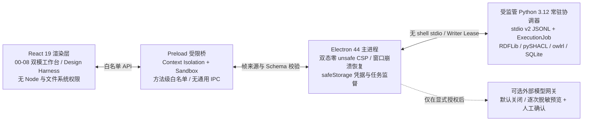

<div align="center">
  
  <h1>OntoLearn Studio</h1>
  <p>
    <strong>本地优先（Local-First）的零代码与语义图谱本体学习与落地桌面工作台</strong>
  </p>
  <p>
    <strong>简体中文</strong> | <a href="README.en.md">English</a>
  </p>
  <p>
    <a href="https://github.com/NOmoreJoke/OntoLearn-Studio/releases/latest">
      
    </a>
    <a href="https://github.com/NOmoreJoke/OntoLearn-Studio/actions/workflows/ci.yml">
      
    </a>
    <a href="LICENSE">
      
    </a>
    
  </p>
</div>

---

**OntoLearn Studio** 是一款面向零代码业务/产品人员与本体工程师的桌面应用，将 **零代码概念沙盒**、**标准 RDF/SHACL 语义建模工作台**、**SQLite 单事务快照存储** 与 **受控离线教学系统** 整合在一个默认离线运行的本地环境中。最终用户安装桌面端后，无需预先配置 Python 或 Node.js 即可直接打开使用。

---

## 核心特性

1. **本地优先（Local-First）与零外发默认安全**
   - 内置随包冻结的 Python 3.12 语义引擎（RDFLib + pySHACL + owlrl）与 SQLite 单库原子事务存储，所有项目数据与检查点保存在本地。
   - 零账号体系、零遥测上报；可选的外部模型助手默认关闭，启用前须经过本地凭据加密存储（`safeStorage`）、脱敏负载预览与人工逐次确认，且仅生成供人工审核的变更草稿，绝不绕过确认直接落库。
2. **零代码业务直觉 ↔ 标准语义图谱同源双视图**
   - 默认新手视图隐藏裸 `<urn:...>` 命名空间、N3 字面量类型后缀与原始 JSON 快照，通过 **Excel 行拆积木**、**PRD 原句四色圈词**、**自然语言下拉造句器** 与三列可读变更预览（`ReadableBusinessDiff`）降低理解门槛。
   - 支持一键切换至 **标准 RDF/IRI 视图**，并可随时展开底层三元组或 JSON 原文抽屉，实现业务直觉与严谨图谱同源对照。
3. **双案例渐进学习与双规模仿真数据**
   - 配套 **Lv.1 知味茶饮 · 全渠道会员与门店订单履约**（零代码推荐入门）与 **Lv.2 智能工厂 · 设备运维与告警闭环**（进阶工程迁移），支持 **10 行微缩沙盒集** 与 **80 行含脏数据压力集** 一键切换。
4. **可解释验证与确定性回滚**
   - 每次写入均经预览—确认—原子提交，生成不可变版本快照与精确的下游失效原因映射，支持检查点整库恢复、离线导师分步校验与整包 `.zip` 迁移。

---

## 双案例学习路径

| 案例级别                 | 主题场景                                | 命名空间前缀 | 核心数据集与学习定位                                                                                                                                                                                             |
| :----------------------- | :-------------------------------------- | :----------- | :--------------------------------------------------------------------------------------------------------------------------------------------------------------------------------------------------------------- |
| **Lv.1（零代码推荐）**   | **知味茶饮 · 全渠道会员与门店订单履约** | `retail:`    | 含 `members`、`stores_staff`、`orders`、`complaints` 四张业务源表；提供 **10 行微缩集**（理清三元组、同名消歧、事件实体化）与 **80 行含脏数据压力集**（验证 SHACL 体检与规则推导拦截负金额/悬空店长/高风险会员） |
| **Lv.2（进阶工程迁移）** | **智能工厂 · 设备运维与告警闭环**       | 工程本体示例 | 保留完整离线课程资产、映射模板、SPARQL 查询练习与迁移检修案例，适合工程化建模与规则推导深度实操                                                                                                                  |

---

## `00` – `08` 全链路工作台矩阵

| 模块       | 名称                    | 核心能力                                                                                                                                                        |
| :--------- | :---------------------- | :-------------------------------------------------------------------------------------------------------------------------------------------------------------- |
| **`00`**   | **三元组与概念沙盒**    | 6 步零代码微关卡：Excel 宽表拆 `S–P–O` 三元组、同名消歧（IRI vs Label）、对象关系 vs 数值属性、类与个体层级、PRD 四色圈词与坏模型重构诊所、显式断言 vs 规则推导 |
| **`01`**   | **本体构建**            | `[零代码业务视图 \| 标准 RDF/IRI 视图]` 一键切换、下拉自然语言造句器、`ReadableBusinessDiff` 三列变更预览与事务原子提交                                         |
| **`02`**   | **数据映射**            | CSV / Excel (`.xlsx`) 导入映射、稳定个体身份校验、非法输入拦截与快照可追溯导入                                                                                  |
| **`03`**   | **本体查询**            | 仅限本地只读的 SPARQL 与可视化查询构造，禁 `SERVICE` 与写更新，支持有界分页、同快照关系图、历史快照重跑与 CSV 导出                                              |
| **`04`**   | **质量与推导**          | pySHACL 结构体检、单阶段受控规则与 RDFS/OWL-RL 子集推导、10 行 / 80 行双规模仿真体检与白话推导证据链                                                            |
| **`05`**   | **行为定义**            | 事件触发规则定义与沙盘检验，关联前序快照与失效状态追踪                                                                                                          |
| **`06`**   | **情景推演**            | 多轮业务指标情景推演与结果对比（基于显式规则与输入情景，非黑盒统计预测）                                                                                        |
| **`07`**   | **迁移练习**            | 解锁后的独立迁移排错与分类练习关卡，配合离线课程检验闭环                                                                                                        |
| **`08`**   | **导出与迁移**          | 整项目 `.zip` 导出与安全导入、检查点整库恢复、带版本与过期标识的自包含 HTML 报告导出                                                                            |
| **侧边栏** | **课程导师 \| AI 助手** | 离线即可完成全部分阶提示与课程验收；接入可选模型 Key 后提供严格脱敏审核的草稿辅助                                                                               |

---

## 进程安全与系统架构



---

## 桌面安装包下载与校验

前往 [GitHub Releases 最新版](https://github.com/NOmoreJoke/OntoLearn-Studio/releases/latest) 下载对应平台安装包：

| 平台        | 目标架构                       | 安装包格式                             | 社区无签名构建首次启动说明                                                                                                             |
| :---------- | :----------------------------- | :------------------------------------- | :------------------------------------------------------------------------------------------------------------------------------------- |
| **macOS**   | Apple Silicon (`arm64`, M1–M4) | `OntoLearn.Studio-<version>-arm64.dmg` | 打开 DMG 拖入「应用程序」；若提示「无法验证开发者」，在终端执行一次：<br>`xattr -cr "/Applications/OntoLearn Studio.app"` 即可正常打开 |
| **Windows** | Windows 10 / 11 (`x64`)        | `OntoLearn.Studio.Setup.<version>.exe` | 安装向导支持自定义安装目录（如 `D:\OntoLearn Studio`）；若弹出 Windows SmartScreen 提示，点击 **「更多信息 → 仍要运行」** 即可         |

> 说明：仓库工作流支持注入 Apple `CSC_LINK` / 公证凭据或 Windows `WIN_CSC_LINK` 构建正式签名包；未注入外部签名凭据时，自动发布带 `SHA256SUMS.txt` 的社区无签名安装包。

### 下载后校验 SHA-256

下载安装包与同版本的 `SHA256SUMS.txt` 后，可执行哈希校验：

```bash
# macOS / Linux
shasum -a 256 -c SHA256SUMS.txt
```

```powershell
# Windows PowerShell
Get-FileHash .\OntoLearn.Studio.Setup.0.1.0.exe -Algorithm SHA256
```

---

## 源码开发与本地验证

开发环境依赖 **Node.js 24**（见 `.node-version`）、**Python 3.12**（见 `.python-version`）与 **[uv](https://docs.astral.sh/uv/getting-started/installation/)**。

```bash
git clone https://github.com/NOmoreJoke/OntoLearn-Studio.git
cd OntoLearn-Studio
git switch develop
npm ci
uv sync --frozen
npm run dev
```

### 常用工程与门禁命令

| 命令                                    | 说明                                                                              |
| :-------------------------------------- | :-------------------------------------------------------------------------------- |
| `npm run dev`                           | 启动桌面应用与仅绑定 `127.0.0.1` 的 Vite 热更新服务                               |
| `npm run check`                         | 全量门禁：ESLint + Prettier 格式检查 + TypeScript + Vitest + 构建 + Ruff + Pytest |
| `npm run verify:sources`                | 校验 `docs/source-manifest.json` 锁定的 12 份归档源文件 SHA-256 一致性            |
| `node scripts/check-design-harness.mjs` | 校验渲染层语义 Token 与 Design Harness 确定性规则                                 |
| `npm run test:e2e`                      | 运行真实 Electron Playwright E2E（Linux 需加 `xvfb-run -a`）                      |
| `npm run package:dir`                   | 构建当前平台应用目录包（含 PyInstaller 冻结 Python 运行时）                       |
| `npm run release:hygiene`               | 对 `release/` 产物执行 extraResources、第三方许可与零密钥残留检查                 |

---

## 目录导览与文档索引

```text
apps/desktop/         Electron 44 主进程、受限 preload、React 19 渲染层、图标与打包配置
packages/contracts/   TypeScript / Python 共享 v2 协议契约与 Zod 运行时校验
packages/engine/      Python 3.12 常驻协调器、SQLite 事务快照存储、PyInstaller 入口与引擎单测
content/learning/     离线课程包、练习校验集与术语表
design/               V1 归档原型与 V2 演进原型（.pen）
design-harness/       四层前端设计底座与组件状态规范
licenses/             第三方开源组件原始许可证与 NOTICE 索引
scripts/              引擎打包、设计门禁、发布卫生核验与分级审查脚本
tests/                单元测试、fast-check 属性测试与 Electron E2E 测试
docs/                 PRD 基线、架构决策（ADR）、开发指南、验证矩阵与发布手册
```

- 英文主页：[README.en.md](README.en.md)
- 版本变更记录：[CHANGELOG.md](CHANGELOG.md)
- 贡献与协作指南：[CONTRIBUTING.md](CONTRIBUTING.md)
- 安全策略与漏洞披露：[SECURITY.md](SECURITY.md)
- 仓内文档总索引：[docs/README.md](docs/README.md) · [开发指南](docs/development.md) · [验证规范](docs/verification/VERIFY.md)

---

## 语义能力边界声明

为保持工程透明度，当前版本明确界定以下语义边界：

- **支持范围**：RDF / RDFS 基础建模与继承、SHACL 核心形状约束校验（pySHACL）、受控单阶段规则与 OWL-RL 子集推导（owlrl）、仅限本地存储的只读 SPARQL 查询（`SELECT` / `CONSTRUCT` 等只读形式，受分页与超时约束）。
- **明确限制**：不支持无边界完整 OWL DL 推理，不支持 SPARQL `SERVICE` 联邦外联查询与 SPARQL Update 写操作，模型助手不直接代替确定性引擎产出结论或跳过人工确认提交数据。

---

## 开源协议与致谢

本项目基于 **[Apache License 2.0](LICENSE)** 开源发布。随包分发的第三方开源组件（包括 Electron、CPython、RDFLib、pySHACL、owlrl、openpyxl、defusedxml、React、Zod 等）保留各自原始许可证，完整路径索引见 [licenses/NOTICE](licenses/NOTICE)。

欢迎通过 [Issues](https://github.com/NOmoreJoke/OntoLearn-Studio/issues) 与 [Pull Requests](https://github.com/NOmoreJoke/OntoLearn-Studio/pulls) 参与改进；安全问题请按 [SECURITY.md](SECURITY.md) 指引私密报告。
